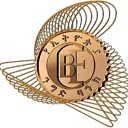

# CheckBirr 💵

Verify payment screenshots instantly ⚡

---

## Installation

```bash
npm install checkbirr
```

## Usage

```ts
import checkbirr from "checkbirr";

async function main() {
  try {
    const output = await checkbirr({
      imagePath: "./screenshot.jpg",
      amount: 5000,
      receiverAccounts: [
        {
          bank: "CBE",
          receiverName: "John Doe Smith",
          receiverAccountNumber: "1000*****",
        },
      ],
    });

    console.log(output);
  } catch (error) {
    console.log(error);
  }
}

main();
```

## Output

```ts
{
    verified:true,
    bank:"CBE",
    senderName:"Rip Van Winkle",
    senderAccountNumber:"1000*****",
    receiverName:"John Doe Smith",
    receiverAccountNumber:"1000*****",
    date:"Nov 02, 2026, 4:36 PM",
    transactionID:"FM43812X",
    amount:5000,
}
```

## How it works

CheckBirr scans the QrCode present on the screenshot and navigates to the official website of the bank to extract transaction details.
After the details are extracted it simply compares the values provided by the developer with the ones retrieved from the website.
Finally, deming the transaction as verified or not depending on the similarity of the two values.

## Why use CheckBirr

CheckBirr does **NOT** simply scan the screenshot and extract the transaction details using OCR scanning, But rather
It scans the QrCode present on the screenshot and uses browser automation to extract the information from the official site provided by the bank.
This makes it very reliable and impossible to trick with fake or edited screenshots.

## Note

This library does **NOT** detect duplicate transactions and it is up to the developer to keep a history of transactions in order to detect duplicate receipts.

## Supported Banks



## Disclaimer

This is **NOT** an official api or library published by the banks supported.

## License

This project is licensed under the **MIT License**.
